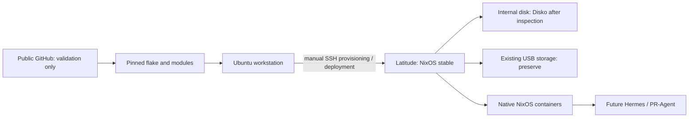

# Declarative NixOS homelab

Public infrastructure definitions for a headless Dell Latitude, developed on a separate Ubuntu workstation with Determinate Nix. **Phase 0 only: no server has been inspected, installed, or deployed.**

The target is x86_64-linux, a Dell Latitude 5300 with Intel Core i7-8665U and 32 GiB RAM, an approximately 1 TB internal NVMe, and two external 4 TB USB drives providing approximately 4 TB usable storage. The audited USB topology is an existing healthy mdadm RAID1 with ext4. External storage must survive migration intact.



## Architecture and status

NixOS 26.05 is the selected stable release ([official release](https://nixos.org/blog/announcements/2026/nixos-2605/)). Standard Nix from NixOS runs on the server; Determinate Nix is only a workstation tool. Flakes pin nixpkgs, Disko, sops-nix and nixos-anywhere. Small explicit modules configure systemd, networkd, SSH and firewall policy.

The public flake exports no installable host. Actual deployment uses a separate ignored `local/flake.nix`, importing the exported `nixosModules.latitude` and private hardware profile. The public Git flake never imports ignored files. See [installation](docs/installation.md) for setup and exact evaluation commands. Disk, SSH key and network prerequisites remain enforced; validation cannot prove hardware facts.

CI separately evaluates non-deployable module fixtures, including the opt-in container. It never builds an installable validation system. Passing checks means module validation, **not deployment readiness**.

Implemented: stable locked flake, core system modules, SSH/firewall, conditional internal-disk UEFI/ext4 layout, sops integration, inactive storage/NFS/Restic/Tailscale scaffolds, offline example container, staged native Hermes container integration, native Home Assistant Core with local-only ZHA support, local checks and CI.

Home Assistant is UI-managed at `/var/lib/home-assistant`, with its frontend restricted to the wired `192.168.8.0/24` LAN. See [Home Assistant](docs/home-assistant.md) for the behavioral contract, manual deployment procedure, and ZHA onboarding.

Prepared privately after audit: hardware settings and existing RAID assembly/mount. Planned: post-install storage verification and NFS activation, enrolled Tailscale, tested backups, Hermes state migration and activation, monitoring, and verified PR-Agent packaging. No backups or services have been deployed.

## Layout

- `hosts/latitude/`: host composition, conditional Disko, hardware example.
- `modules/`: core, networking, storage, security and native containers.
- `services/`: fail-closed Hermes and PR-Agent integration points, plus native Home Assistant.
- `tests/`: non-deployable fixtures and policy/evaluation/format checks.
- `secrets/`: encrypted files only, after recipient setup.
- `docs/`: installation, deployment, storage, containers, security, recovery, architecture, Home Assistant, and ADRs.
- `.github/workflows/checks.yml`: validation without deployment.
- `local/`: ignored private hardware configuration; preserve separately.

## Development

```sh
git switch -c feature/describe-change
nix develop
nix fmt
nix flake check --no-update-lock-file
```

No system tool installation is required. Nix downloads pinned development/build dependencies into its store. Newly created source files must be visible to Git (`git add -N PATH`) for Git-flake evaluation. Review `git diff` and the public/private boundary before committing. Commit, open a PR, let CI validate, review and merge; deploy manually only in a later authorized task. No GitHub repository has been published.

Use [installation](docs/installation.md) for initial nixos-anywhere provisioning and [deployment](docs/deployment.md) for subsequent nixos-rebuild changes. Both run from Ubuntu and explicitly target the remote machine. Never activate NixOS on Ubuntu.

## Security and preservation

Key-only SSH and a firewall are configured. The dedicated `admin` key grants root-equivalent access through passwordless sudo; keep those keys tightly controlled. LAN SSH must be verified before restricting administration to Tailscale. No automatic Tailscale enrollment or public agent endpoint exists. Runtime secrets use sops-nix; plaintext, personal state and private hardware settings stay outside public history. See [security](docs/security.md).

Disko describes only one inspected internal drive. No USB device, mount or NFS export is activated. Storage consumers must depend on the real mount so failure cannot redirect writes into the system disk. A mirror is not an independent backup. See [storage](docs/storage.md).

## Roadmap

0. **Foundation:** flake, modules, Disko integration, provisioning docs, CI, secrets scaffold and container example (this repository).
1. **Physical installation:** inspect hardware/topology, back up data, fill private settings, test installation, install remotely, verify SSH and networking.
2. **Core infrastructure:** preserve USB mounts/NFS, enroll Tailscale, test independent Restic backup and restore, add monitoring.
3. **AI agents:** Hermes migration, on-demand PR-Agent, persistent state and isolation.
4. **Development infrastructure:** optional GitHub automation, runners, remote builder, binary cache and benchmarking.
5. **Experiments:** optional microvm.nix, sandboxed coding agents, agent evaluations and performance regression tests.

## Audited Latitude 5300 preparation

The hardware audit has been supplied. A private `local/latitude.nix` now selects the exact internal NVMe, confirmed UEFI, wired DHCP, the intended administrator and SSH port, existing mdadm RAID1 identities, UUID-based data mount and preserved NFS export settings. See ignored `local/latitude-notes.md` for the specific inventory and connection details. Preserve these private files independently; a public clone does not contain them.

Disko now lays out GPT, a 1 GiB ESP, 16 GiB swap and remaining ext4 root. **Applying this layout erases Debian and all internal-drive state, including Hermes.** External RAID disks and `/dev/md0` never enter Disko. RAID mounting is prepared for the installed system; `nofail` preserves administrative boot access if storage is absent, and NFS remains disabled until post-install verification.

The real administrator public key is still missing. Insert it in `homelab.adminKeys` in ignored `local/latitude.nix`; the production system cannot build until then. Read [installation](docs/installation.md), [Hermes backup inventory](docs/hermes-migration.md), and [current validation](docs/latitude-validation.md). No installation or remote connection has occurred.
